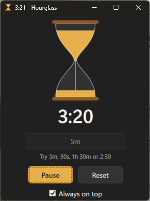

# Hourglass

A small countdown timer for Windows 11 with an animated hourglass.



## Features

- Type a duration and press **Start** (or Enter). Accepted formats:

  | You type  | Meaning              |
  |-----------|----------------------|
  | `5`       | 5 minutes            |
  | `5m`      | 5 minutes            |
  | `90s`     | 90 seconds           |
  | `1h 30m`  | 1 hour 30 minutes    |
  | `1.5h`    | 1 hour 30 minutes    |
  | `2:30`    | 2 minutes 30 seconds |
  | `1:15:00` | 1 hour 15 minutes    |

- **Pause**, **Resume** and **Reset**.
- The sand drains from the top bulb to the bottom as time runs out.
- **Compact mode**: click the hourglass to hide the controls and shrink the
  window to just the hourglass and countdown. Click it again to bring them back.
  In compact mode, Space or Enter starts and pauses the timer.
- **Always on top** option.
- Progress is shown on the taskbar button and the remaining time in the window title.
- When time is up, the app plays the system alert sound, comes to the front
  and switches back to full mode.

## Requirements

- Windows 10 or 11
- [.NET 8 SDK](https://dotnet.microsoft.com/download) or newer

## Build and run

From the project folder:

```
dotnet run
```

Or open `Hourglass.csproj` in Visual Studio 2022 and press F5.

To produce a standalone build:

```
dotnet publish -c Release
```

## Project layout

| File                 | Purpose                                          |
|----------------------|--------------------------------------------------|
| `Hourglass.csproj`   | Project file                                     |
| `App.xaml` / `.cs`   | Application entry point                          |
| `MainWindow.xaml`    | Window layout and the hourglass drawing          |
| `MainWindow.xaml.cs` | Timer, duration parsing, animation, compact mode |
| `Hourglass.ico`      | Application icon                                 |
| `Hourglass.png`      | Screenshot shown in this README                  |
